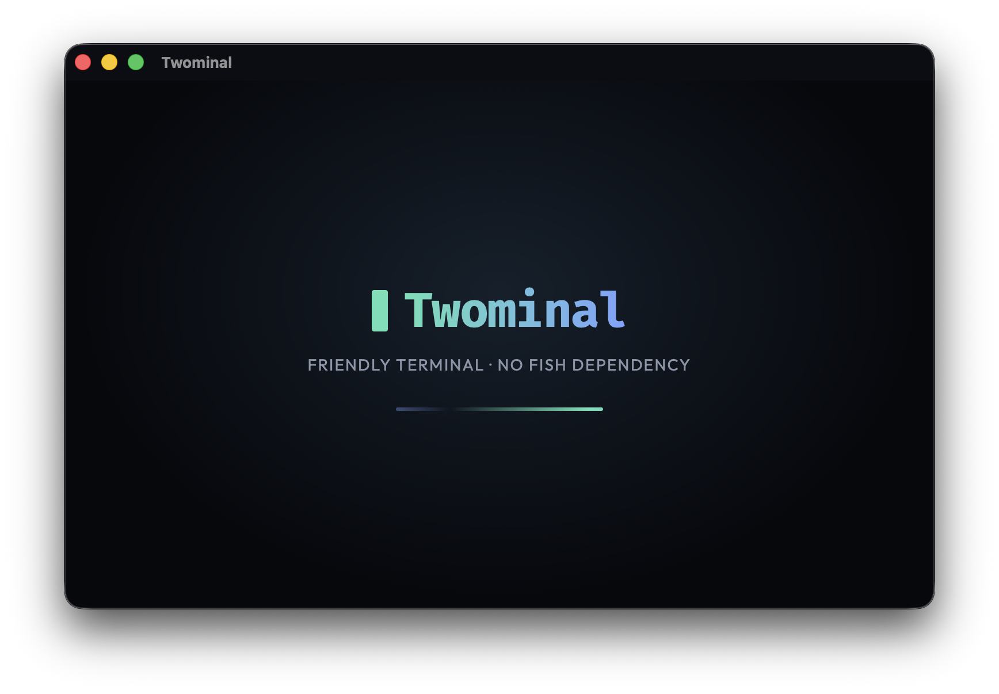
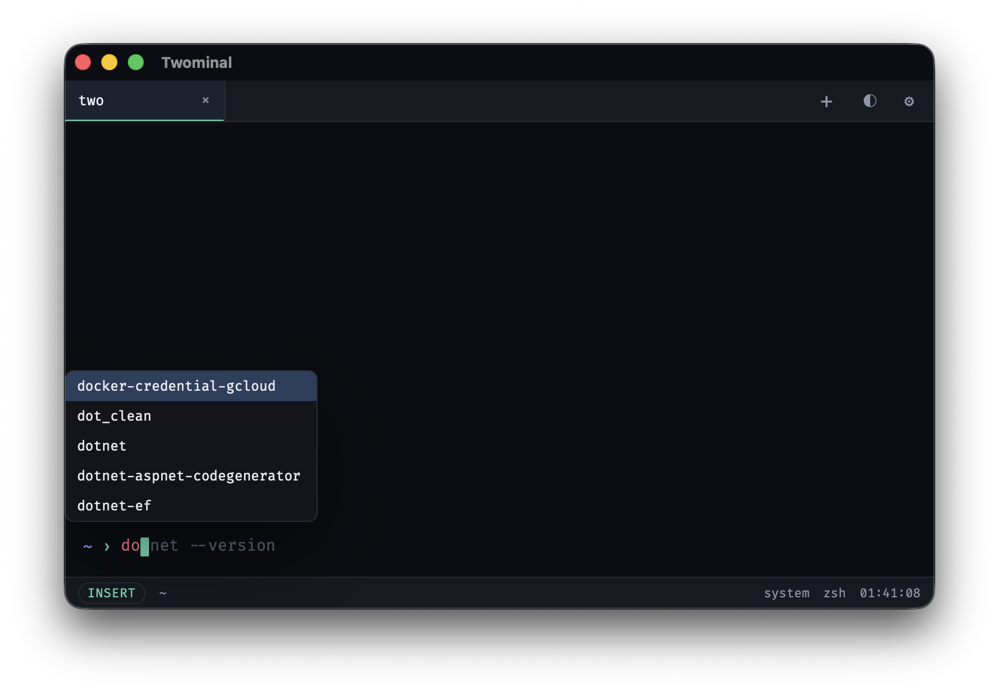
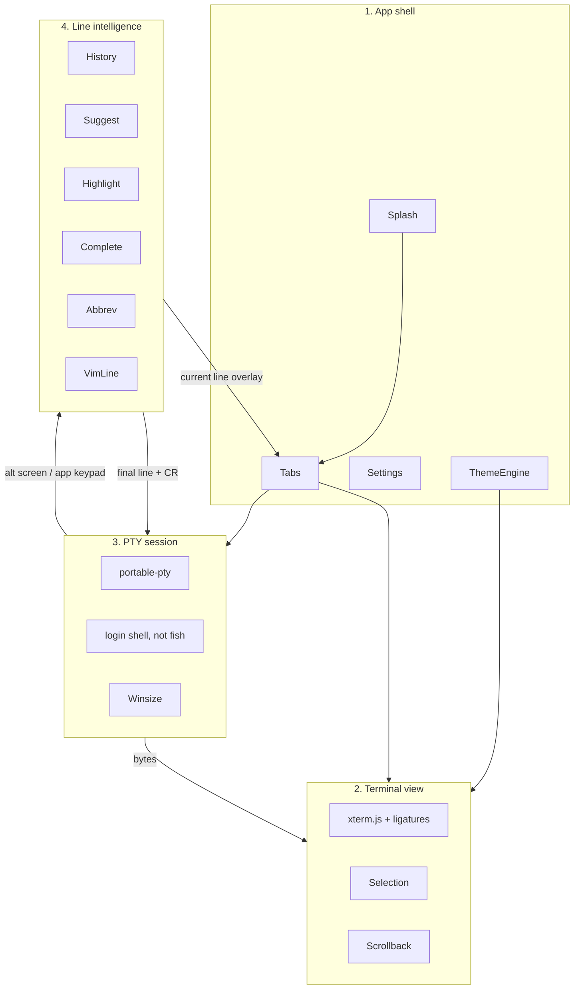

# Twominal

Friendly terminal, Fish-like UX, **no Fish dependency**.

[](https://github.com/two-net/twominal/actions/workflows/release.yml)

Twominal is a Tauri 2 + Rust desktop terminal. Each tab is a real PTY running your login shell (`zsh` / `bash` / `pwsh` / `cmd` — never `fish`). Fish-like editing (highlight, autosuggest, completion, abbreviations, vim mode) is implemented in Twominal’s line editor.

Installers for macOS, Windows, and Linux are on [GitHub Releases](https://github.com/two-net/twominal/releases).

### Install on macOS

```sh
curl --proto '=https' --proto-redir '=https' -fsSL https://raw.githubusercontent.com/two-net/twominal/main/install.sh | sh
```

[`install.sh`](install.sh) downloads the matching `.dmg` from [GitHub Releases](https://github.com/two-net/twominal/releases), checks `SHA256SUMS.txt`, verifies the ad-hoc signature, and installs `Twominal.app` to `/Applications`. It prompts for administrator access if that directory is not writable. It refuses to overwrite an existing copy; set `TWOMINAL_FORCE=1` to replace, or `TWOMINAL_INSTALL_DIR` to another absolute path. Pin a version with `TWOMINAL_VERSION=0.1.0`.

`curl` does not set the browser quarantine flag, so this usually skips **Open Anyway**. The app is still ad-hoc signed and not notarized; MDM can still block it.

To install from a checkout: `sh install.sh`.

**Browser / DMG:** download the `.dmg`, then **right-click Twominal.app → Open → Open** the first time. Building from source (`npm run tauri build`) also avoids the Gatekeeper prompt on that machine.

The only way a browser-downloaded app opens with no prompt on every Mac is a $99/year [Apple Developer Program](https://developer.apple.com/programs/) membership, then Developer ID signing and notarization.

<p align="center">
  
</p>

<p align="center">
  
</p>

## Run

Prerequisites: Rust (stable), Node 20+, and platform webview deps.

```sh
npm install
npm run tauri dev
```

### macOS

Xcode Command Line Tools. Then the commands above.

```sh
xcode-select --install   # if needed
npm install
npm run tauri dev
```

### Linux

WebKitGTK and typical Tauri deps, e.g. Debian/Ubuntu:

```sh
sudo apt install libwebkit2gtk-4.1-dev build-essential curl wget file libxdo-dev libssl-dev libayatana-appindicator3-dev librsvg2-dev
npm install
npm run tauri dev
```

### Windows

MSVC Build Tools + WebView2 runtime. PowerShell:

```powershell
npm install
npm run tauri dev
```

### Release build

```sh
npm run tauri build
```

Artifacts land in `src-tauri/target/release/bundle/`.

## GitHub Release

Pushing a version tag builds every desktop target with GitHub Actions and publishes a GitHub Release. The tag (without the leading `v`) must match `package.json`, `src-tauri/tauri.conf.json`, and `src-tauri/Cargo.toml`.

```sh
git tag v0.1.0
git push origin v0.1.0
```

You can also run **Release** from the Actions tab. Builds stay draft until every platform succeeds, then the workflow undrafts the release and attaches `SHA256SUMS.txt`.

macOS CI uses ad-hoc signing unless you add paid Apple Developer secrets. See [Install on macOS](#install-on-macos). Windows installers are unsigned; SmartScreen may warn.

## Architecture

Hybrid by default: we own the current command line; the child shell runs commands. Full-screen TUIs take over the PTY. Settings → **Raw PTY** disables the line editor.



| Layer | Where |
|---|---|
| App shell | `src/main.ts`, splash + tabs + settings |
| Terminal view | `src/session.ts` (xterm.js, Fit, Ligatures) |
| PTY | `src-tauri/src/pty.rs` (`portable-pty`, ConPTY on Windows) |
| Line intelligence | `src/editor.ts`, `highlight.ts`, `complete.ts`, `history.ts` |

Passthrough (keys go straight to the child) when:

- Raw PTY is on
- Alternate screen is on (`vim`, `less`, `htop`)
- Application cursor keys are on
- A command is running (until the idle OSC)

There is **no** `fish` binary, crate, submodule, or subprocess.

## Config

Copied on first launch to:

- macOS: `~/Library/Application Support/twominal/config.json`
- Linux: `~/.config/twominal/config.json`
- Windows: `%APPDATA%\twominal\config.json`

See [`config.sample.json`](config.sample.json).

History: `…/twominal/history` under the local data dir.

## Keybindings

### App

| Key | Action |
|---|---|
| `Cmd/Ctrl+T` | New tab |
| `Cmd/Ctrl+W` | Close tab |
| `Ctrl+Tab` / `Ctrl+Shift+Tab` | Next / previous tab |
| `Cmd/Ctrl+1…9` | Jump to tab |
| `gt` / `gT` | Next / previous tab (vim mode, NORMAL only) |

### Hybrid line editor — INSERT

| Key | Action |
|---|---|
| printable | Insert |
| `Right` or `Ctrl-F` at end of line | Accept autosuggestion |
| `Tab` | Complete (files, PATH commands, known flags) |
| `Space` | Expand abbreviation if the token matches |
| `Enter` | Send line to the PTY |
| `Up` / `Down` | History |
| `Ctrl/Cmd-C` | Clear line, or SIGINT if empty |
| `Ctrl/Cmd-D` | EOF if line empty |
| `Ctrl/Cmd-L` | Form feed / clear |
| `Esc` | NORMAL (if vim mode on) |

### Hybrid line editor — NORMAL / VISUAL

| Key | Action |
|---|---|
| `h` `l` `0` `$` `w` `b` | Motions |
| `j` / `k` | History next / previous |
| `x` | Delete character |
| `dd` | Clear line |
| `i` `a` `I` `A` | Enter INSERT |
| `v` | VISUAL |
| `y` / `d` in VISUAL | Yank / delete to internal clipboard |
| `p` | Paste internal clipboard |

### Raw / TUI (passthrough)

Keys, including `Ctrl-C` `Ctrl-Z` `Ctrl-D`, go to the child. `Cmd+C` / `Ctrl+Shift+C` copies a selection; `Cmd+V` / `Ctrl+Shift+V` pastes.

## Ligatures

Enable **Ligatures** in settings and pick **JetBrains Mono** or **Fira Code** (bundled). Sequences like `!=` `=>` `->` `==` render as ligatures.

## Default abbreviations

- `ll` → `ls -la`
- `gco` → `git checkout`
