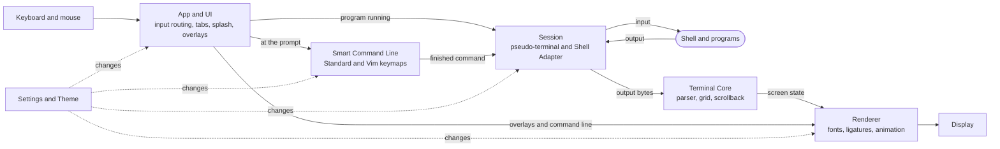

# Twominal — Software Requirements Specification

**Version** 0.1 (draft) · **Date** 2026-10-25 · **Status** For review

> This document defines *what* Twominal must do and *how well*, not *how* it is built. It deliberately prescribes no technology stack.

## Contents

1. [Introduction](#1-introduction)
2. [Overall description](#2-overall-description)
3. [External interface requirements](#3-external-interface-requirements)
4. [Functional requirements](#4-functional-requirements)
5. [Non-functional requirements](#5-non-functional-requirements)
6. [Architecture overview](#6-architecture-overview)
7. [Acceptance tests](#7-acceptance-tests)
8. [Out of scope](#8-out-of-scope)
9. [Open questions](#9-open-questions)

Appendices: [A — Default keyboard shortcuts](#appendix-a--default-keyboard-shortcuts) · [B — Vim key reference](#appendix-b--vim-key-reference) · [C — Default settings](#appendix-c--default-settings) · [D — fish feature coverage](#appendix-d--fish-feature-coverage)

---

## 1. Introduction

### 1.1 Purpose

This Software Requirements Specification (SRS) defines the functional and non-functional requirements for **Twominal**, a desktop terminal application. It is written for everyone who designs, builds, tests, or approves Twominal.

The document is technology-neutral. It does not prescribe programming languages, frameworks, libraries, rendering techniques, or file formats; any implementation that meets these requirements is acceptable.

### 1.2 Scope

Twominal runs the user's existing shell, such as zsh or bash, and adds:

- a **smart command line** with fish-style autosuggestions, syntax highlighting, and rich tab completion, built into the terminal so it works **without the fish shell**;
- a polished experience: a **splash screen**, purposeful **animation**, **Dark / Light / System** themes with System as the default, and **font ligatures**;
- first-class **Vim** support: Vim-style editing of the command line, Vim-style navigation of the scrollback, and flawless hosting of Vim and Neovim;
- a deliberately **simple architecture**.

**Goals**

| ID | Goal |
|---|---|
| G-1 | Any supported shell feels like fish on first launch, with zero configuration. |
| G-2 | Polish never costs speed: animation never delays input or output. |
| G-3 | A new contributor can understand the whole architecture from one diagram. |
| G-4 | Vim users can stay in modal editing throughout the app. |

**Traceability to the original request**

| Request | Covered by |
|---|---|
| Application like a terminal | §4.1 Terminal core |
| Named Twominal | UI-01, SI-02, SPL-01 |
| Animation | §4.4 Animation; also SPL-01, THM-04, VIM-04 |
| Dark / light / system, system by default | §4.3 Appearance and themes |
| fish shell features, without fish shell | §4.6 Smart command line, C-02, Appendix D |
| Font ligatures | §4.5 Fonts and ligatures |
| Simple architecture | §5.5 Maintainability, §6 Architecture overview |
| Splash screen | §4.2 Splash screen |
| Vim | §4.7 Vim, Appendix B |

### 1.3 Definitions

| Term | Meaning |
|---|---|
| Shell | The command interpreter running inside Twominal, e.g. zsh or bash. |
| Session | One running shell plus its terminal state. Each tab holds one session. |
| Shell Adapter | The part of a session that knows one specific shell: how to detect its prompt, its syntax, and how to list its aliases and functions. |
| Pseudo-terminal | The operating-system facility that connects Twominal to the shell. |
| Prompt state | The shell is idle at its prompt, waiting for a command. |
| Program state | A command or program runs in the foreground, e.g. `vim`, `ssh`, `python`. |
| Smart command line (SCL) | Twominal's built-in command editor that provides fish-style features during prompt state. |
| Autosuggestion | A dimmed inline prediction of the rest of the command, shown after the cursor. |
| Completion menu | The list of candidates, with descriptions, shown when Tab finds several matches. |
| Abbreviation | A short word that expands into longer text when followed by Space or Return, e.g. `gco` → `git checkout`. |
| Ligature | One glyph that a font draws for a sequence of characters, e.g. `->`, `=>`, `!=`. |
| Alternate screen | The separate screen that full-screen programs such as Vim draw on. |
| Scrollback | Lines that have scrolled off the top of the screen and can be scrolled back to. |
| Vim mode | Modal editing (Normal, Insert, Visual, Replace) with Vim key bindings. |
| Copy mode | A Vim-style keyboard cursor for moving through, searching, and selecting scrollback text. |
| Effective theme | The theme in use right now: Dark or Light. *System* resolves to one of them. |
| Reduce Motion | The operating system's accessibility setting that asks apps to minimize motion. |

### 1.4 Conventions

- **IDs.** Each requirement has a stable ID of the form `AREA-NN`, e.g. `SCL-10`. Removed IDs are not reused.
- **Priority (MoSCoW).** **Must**: required for release 1.0. **Should**: important; may slip only by explicit agreement. **Could**: desirable if time allows.
- **Wording.** "Shall" states a requirement. Notes and examples are informative.
- **Keys.** macOS symbols are used: ⌘ Command, ⌥ Option, ⌃ Control, ⇧ Shift, ↩ Return, ⌫ Delete. Every default shortcut can be changed (SET-05).

### 1.5 References

- fish shell documentation, behavioral reference for §4.6: <https://fishshell.com/docs/current/>
- Vim reference manual, behavioral reference for §4.7: <https://vimhelp.org/>
- XTerm Control Sequences, compatibility baseline for §4.1: <https://invisible-island.net/xterm/ctlseqs/ctlseqs.html>
- ECMA-48, *Control Functions for Coded Character Sets*
- WCAG 2.2, contrast criteria used in §4.3: <https://www.w3.org/TR/WCAG22/>

---

## 2. Overall description

### 2.1 Product perspective

Twominal is a standalone desktop application that replaces the operating system's built-in terminal. It sits between the user and the shell:

- **Output:** shell → Twominal's terminal core → screen.
- **Input at the prompt:** keyboard → smart command line → on ↩, the finished command goes to the shell exactly as if it had been typed.
- **Input while a program runs:** keyboard → straight to the program, untouched.

Because the fish-style features live in Twominal rather than in the shell, they behave the same in zsh and bash, and users keep their shell, configuration, aliases, and history.

### 2.2 Product functions

- Run the user's shell in windows and tabs with complete, standards-compatible terminal emulation.
- Show an animated splash screen on launch.
- Offer Dark, Light, and System themes, System by default, switching live with the OS.
- Animate state changes smoothly while honoring Reduce Motion.
- Render programming ligatures without breaking the character grid.
- Provide fish-style autosuggestions, syntax highlighting, completions with descriptions, history search, abbreviations, and editing shortcuts for any supported shell.
- Provide a Vim mode for the command line, a Vim-style copy mode, and full compatibility with Vim and Neovim.
- Provide a Settings window backed by one human-readable settings file.

### 2.3 User classes

| User class | Characteristics | What matters most |
|---|---|---|
| Everyday CLI user | Developers and administrators who use zsh or bash daily | fish-style convenience without switching shells; speed |
| Vim user | Edits modally; runs Vim or Neovim in the terminal | Vim keys everywhere; perfect rendering; no Esc lag |
| Newcomer | Learning the command line | Suggestions, visible mistakes, discoverable shortcuts |
| Accessibility-focused user | Sensitive to motion, has low vision, or works keyboard-only | Reduce Motion, contrast, large text, full keyboard control |

### 2.4 Operating environment

- **Platform:** macOS, current and previous major release. Requirements stay platform-neutral so that other desktop platforms can follow (POR-02).
- **Shells:** zsh and bash. Other shells run normally, but the smart command line may be unavailable for them.
- **Displays:** standard and high-density, multiple monitors with mixed scaling, 60–120 Hz refresh rates.
- **Input:** any keyboard layout, dead keys, and input methods (IME); mouse and trackpad.
- **Network:** not required.

### 2.5 Constraints

| ID | Constraint |
|---|---|
| C-01 | No technology stack is prescribed. Choices are left to the implementation, bounded by the requirements in this document. |
| C-02 | Twominal shall not bundle, launch, or depend on the fish shell, and shall not include fish source code, scripts, completion files, or other assets. fish serves only as a behavioral reference. |
| C-03 | The architecture shall stay simple, as defined in §5.5 and §6. |
| C-04 | Twominal shall work fully offline. |
| C-05 | Twominal shall not modify the user's shell configuration files without explicit consent, and any such change shall be reversible from Settings. |

### 2.6 Assumptions and dependencies

| ID | Assumption |
|---|---|
| A-01 | The OS provides pseudo-terminals, a light/dark appearance setting with change notifications, and a Reduce Motion setting. |
| A-02 | For supported shells, Twominal can reliably detect where prompts begin and end, for example through lightweight shell integration. Where it cannot, the smart command line steps aside (SCL-03). |
| A-03 | Option descriptions for completions come from Twominal's built-in definitions and from manual pages installed on the system. |
| A-04 | "Reference hardware" for performance targets means a mid-range laptop released within the last three years, on mains power, at default display scaling. |
| A-05 | The default command-line editing mode is Standard; Vim mode is opt-in (Q-01). |

---

## 3. External interface requirements

### 3.1 User interface

| ID | Requirement | Priority |
|---|---|---|
| UI-01 | The product name shall appear as "Twominal" in the application menu, About window, splash screen, and Settings. | Must |
| UI-02 | A window shall consist of the terminal area and a tab bar. The tab bar shall be hidden while the window has a single tab (configurable). | Must |
| UI-03 | The default window title shall show the current directory (home shortened to `~`) and the foreground program. Programs may override it with standard title sequences. | Must |
| UI-04 | Overlays (completion menu, history search, find bar, copy-mode indicator) shall never hide the line being edited. The completion menu opens below the command line and scrolls content up when space is short. | Must |
| UI-05 | Subtle, theme-aware indicators shall show the Vim mode (when enabled), private mode, and when the smart command line is off or unavailable. | Should |
| UI-06 | A Keyboard Shortcuts sheet (⌘/) shall list all current bindings, including the user's changes. | Should |
| UI-07 | On first launch only, after the splash screen, a dismissible one-page tour shall introduce suggestions, completions, themes, and Vim options. | Could |

### 3.2 Hardware interfaces

No special hardware is required. Twominal uses the keyboard, pointing devices (mouse, and trackpad with smooth scrolling), and any display the OS supports.

### 3.3 Software interfaces

| ID | Interface | Requirement | Priority |
|---|---|---|---|
| SI-01 | Shell | Start the user's login shell (from the user's account, overridable in Settings) on a pseudo-terminal, in the home directory or in the directory of the tab it was opened from. | Must |
| SI-02 | Environment | Set `TERM` to a widely available xterm-compatible value (default `xterm-256color`), `COLORTERM=truecolor`, `TERM_PROGRAM=Twominal`, `TERM_PROGRAM_VERSION` to the app version, and a UTF-8 locale when none is set. | Must |
| SI-03 | OS appearance | Read the light/dark appearance at launch and observe changes. | Must |
| SI-04 | OS accessibility | Read and observe Reduce Motion, and Increase Contrast (THM-08). | Must |
| SI-05 | Clipboard | Copy and paste plain text; accept clipboard writes from programs, subject to SEC-05. | Must |
| SI-06 | Fonts | List installed monospaced fonts; use system fallback fonts for missing glyphs. | Must |
| SI-07 | Manual pages | Read installed manual pages to derive option descriptions for completions. | Should |
| SI-08 | External editor | Launch `$VISUAL`, else `$EDITOR`, else `vim`, to edit the current command line (SCL-63). | Should |
| SI-09 | URL handler | Open links and file paths with the OS default handler. | Should |
| SI-10 | File system | Read directories for completion and path highlighting; store settings and history in the user's per-user configuration and data locations. | Must |

### 3.4 Communication interfaces

Twominal has no network interfaces of its own (C-04). It shall never transmit typed input, terminal content, command history, or settings. Programs running inside Twominal, such as `ssh`, use the network as usual. Any future network feature, such as update checks, shall be opt-in and disclosed.

---

## 4. Functional requirements

### 4.1 Terminal core (TERM)

Before anything else, Twominal must be a dependable everyday terminal.

| ID | Requirement | Priority |
|---|---|---|
| TERM-01 | On launch, Twominal shall open one window with one tab running the user's shell. | Must |
| TERM-02 | Users shall be able to open windows (⌘N) and tabs (⌘T), close them (⌘W), switch tabs (⌘⇧[ and ⌘⇧], ⌘1–⌘9), and drag tabs to reorder them. A new tab starts in the current tab's working directory. | Must |
| TERM-03 | Twominal shall emulate an xterm-compatible terminal, including cursor addressing, scrolling regions, insert/delete/erase operations, the alternate screen, bracketed paste, focus reporting, extended mouse reporting, cursor shape and blink requests, window titles, and synchronized updates. | Must |
| TERM-04 | Text attributes shall include bold, dim, italic, inverse, strikethrough, and underline styles (single, double, curly, dotted, dashed) with an independent underline color. | Must |
| TERM-05 | Color support shall include the 16 theme colors, the 256-color palette, and 24-bit true color. | Must |
| TERM-06 | Text shall be full Unicode (UTF-8): combining marks, wide characters, and emoji (including multi-code-point sequences) occupy the correct number of cells and keep the cursor aligned. | Must |
| TERM-07 | Scrollback shall hold 10,000 lines by default (configurable). When the user has scrolled up, new output does not move the view; a "new output" indicator appears, and typing returns to the bottom. | Must |
| TERM-08 | On resize, Twominal shall report the new size to the running program immediately and reflow wrapped lines on the normal screen. | Must |
| TERM-09 | Mouse selection shall support drag (characters), double-click (word), triple-click (line), and ⌥-drag (rectangle). ⌘C copies and ⌘V pastes. | Must |
| TERM-10 | Find (⌘F) shall search the scrollback, highlight all matches, show a match count, and step between matches; it is case-insensitive by default. | Must |
| TERM-11 | ⌘-click shall open links (including explicit terminal hyperlinks, OSC 8) and file paths; hovering first shows the target. | Should |
| TERM-12 | Keyboard input shall work with every keyboard layout, dead keys, and input-method composition. Each Option key (left and right separately) can be set to **Character** (types special characters and accents, as in other macOS apps) or **Meta** (sends Alt combinations to programs and enables ⌥ shortcuts). Default: left Meta, right Character. | Must |
| TERM-13 | Closing a tab or window, or quitting, while a program other than an idle shell runs shall ask for confirmation and name the program. | Must |
| TERM-14 | When the shell exits, its tab shall close (default) or stay open showing the exit status (setting). | Should |
| TERM-15 | Font size shall zoom per window with ⌘+, ⌘-, and ⌘0. | Should |
| TERM-16 | The bell shall be visual by default (a brief flash, see §4.4), with an optional sound. | Should |
| TERM-17 | ⌘↑ and ⌘↓ shall jump to the previous and next prompt in the scrollback, and one action shall select a command's whole output. Requires prompt detection. | Should |
| TERM-18 | Windows, tabs, and their working directories shall be restored after relaunch. | Could |

### 4.2 Splash screen (SPL)

| ID | Requirement | Priority |
|---|---|---|
| SPL-01 | On a cold start, Twominal shall show a splash screen with the Twominal name and logo and an entrance animation of at most 800 ms. | Must |
| SPL-02 | The splash shall use the effective theme from its first frame. In Dark there shall be no bright flash. | Must |
| SPL-03 | The first session shall start in parallel with the splash. The splash closes when its entrance animation has finished and the session is ready, whichever is later, but never stays longer than 2 s. If the session is still starting then, the window opens with a "Starting shell…" indicator. | Must |
| SPL-04 | Any key or click shall dismiss the splash immediately. Esc only dismisses; other keys typed during the splash or the starting indicator are delivered to the shell once it is ready, never lost. | Must |
| SPL-05 | The splash shall hand over to the main window with a cross-fade of at most 250 ms. | Should |
| SPL-06 | With Reduce Motion on, or Animations set to Reduced or Off, the splash shall be static (fade only) and close as soon as the session is ready. | Must |
| SPL-07 | A setting "Show splash screen on launch" (default on) shall disable the splash entirely. | Must |
| SPL-08 | The splash shall not appear when opening further windows or tabs. | Must |
| SPL-09 | If the shell fails to start, the splash shall give way to an error view that states the reason and offers Retry, Choose Another Shell, and Open Settings. | Must |
| SPL-10 | The splash may show the version number in small text. | Could |

> **Design note (non-binding):** a cursor blinks, types `twominal`, and the splash dissolves into the first prompt.

### 4.3 Appearance and themes (THM)

| ID | Requirement | Priority |
|---|---|---|
| THM-01 | A Theme setting shall offer **Dark**, **Light**, and **System**. The default shall be **System**. | Must |
| THM-02 | In System mode, Twominal shall match the OS appearance at launch and follow every change live, including automatic day/night switching, without restarting or disturbing running programs. | Must |
| THM-03 | The effective theme shall apply to every surface: window chrome, tab bar, terminal background and text, cursor, selection, the 16 terminal colors, syntax-highlighting and autosuggestion colors, completion menu, splash, and Settings. | Must |
| THM-04 | A theme change shall animate as a cross-fade of at most 300 ms, or switch instantly under Reduce Motion. | Must |
| THM-05 | Both themes shall meet WCAG 2.2 AA contrast: default text ≥ 4.5:1 against the background; autosuggestion text and UI controls ≥ 3:1; each chromatic terminal color (palette entries 1–6 and 9–14) ≥ 3:1. | Must |
| THM-06 | Twominal shall answer programs' queries for its foreground and background colors (OSC 10/11), so tools such as Vim and Neovim can choose a matching light or dark scheme. | Should |
| THM-07 | Programs that subscribe to color-scheme change notifications shall be notified when the effective theme changes. | Could |
| THM-08 | When the OS Increase Contrast setting is on, a higher-contrast variant of the effective theme shall be used. | Could |
| THM-09 | Individual theme colors may be overridden in the settings file. | Could |

### 4.4 Animation (ANI)

Animation explains change; it never makes the user wait.

| ID | Requirement | Priority |
|---|---|---|
| ANI-01 | Twominal shall animate: the splash entrance and exit; theme cross-fades; tabs opening, closing, and reordering; the completion menu and history search opening and closing; autosuggestions fading in; cursor blink (smooth fade); cursor shape changes between Vim modes; entering and leaving copy mode; smooth pixel scrolling on trackpads; and the visual bell. | Must |
| ANI-02 | Apart from the splash, animations shall last 100–300 ms and use easing: ease-out for things appearing, ease-in for things leaving. | Must |
| ANI-03 | Animations shall run at the display's refresh rate (60–120 Hz) with ≤ 1% dropped frames on reference hardware. | Must |
| ANI-04 | Animations shall never block or delay input or output. Keystrokes are handled immediately, program output appears immediately, and a new state change interrupts a running animation instead of queuing behind it. Typed characters and program output are never themselves animated. | Must |
| ANI-05 | An Animations setting shall offer **System** (default), **Full**, **Reduced**, and **Off**. System means Full, or Reduced when the OS Reduce Motion setting is on. Reduced replaces movement and scaling with short fades; Off removes all animation. | Must |
| ANI-06 | Animations and cursor blinking shall pause while a window is hidden, minimized, or fully covered. | Must |
| ANI-07 | An optional smooth cursor shall glide to its new position, with a short trail, instead of jumping. It is off by default and never active under Reduced or Off. | Could |

### 4.5 Fonts and ligatures (FNT)

| ID | Requirement | Priority |
|---|---|---|
| FNT-01 | Users shall be able to choose any installed monospaced font, its size, and its line height. | Must |
| FNT-02 | Twominal shall ship a default monospaced font that has programming ligatures and full box-drawing coverage, under a license that allows redistribution. | Should |
| FNT-03 | When the font provides ligatures, Twominal shall render them, e.g. `->`, `=>`, `!=`, `===`, `<=`, `>=`, `&&`, `::`. | Must |
| FNT-04 | A "Font ligatures" setting (default on) shall turn ligatures on and off. | Must |
| FNT-05 | Advanced users shall be able to enable or disable individual font features, such as stylistic sets. | Could |
| FNT-06 | Ligatures shall never alter the grid: a ligature of N characters occupies exactly N cells, and cursor movement, selection, mouse reporting, and copying still work per character. | Must |
| FNT-07 | Ligatures shall form only within runs of identically styled characters; a change of color or attribute between characters prevents a ligature. | Must |
| FNT-08 | When the cursor is inside a ligature, its characters shall be drawn separately so the cursor position is clear (setting, default on). | Should |
| FNT-09 | Ligatures shall render the same in program output and in the smart command line. | Must |
| FNT-10 | Missing glyphs (emoji, CJK, symbols, Powerline and Nerd Font icons) shall render through fallback fonts without breaking alignment. Box-drawing and block characters shall join seamlessly at any size and line height. | Must |
| FNT-11 | Bold and italic shall use the font's real faces when available and be synthesized otherwise. | Must |
| FNT-12 | Font changes shall apply live to all open sessions. | Must |

### 4.6 Smart command line: fish features without fish (SCL)

These requirements reproduce the interactive conveniences fish is known for, implemented inside Twominal so they work with the user's existing shell. fish is never installed, launched, or embedded (C-02). Appendix D maps each fish feature to the requirements below.

#### 4.6.1 General behavior

| ID | Requirement | Priority |
|---|---|---|
| SCL-01 | The smart command line shall work with zsh and bash on a system where fish is not installed. | Must |
| SCL-02 | It shall be active only in prompt state. While a program runs (including full-screen programs, interactive interpreters, password prompts, and `read`), every key goes straight to the program and the smart command line shows nothing. | Must |
| SCL-03 | When prompt state cannot be detected reliably (unsupported shell, remote SSH session, nested shell, or integration turned off), Twominal shall behave as a plain terminal, with no broken display. | Must |
| SCL-04 | On ↩, the command shall be sent to the shell exactly as displayed, so the shell's own history, aliases, functions, and job control keep working. Twominal shall never change a command without showing the change. | Must |
| SCL-05 | The shell's own prompt, including multi-line prompts, right-side prompts, and popular prompt themes, shall display unchanged. | Must |
| SCL-06 | Users shall be able to turn the smart command line off globally or for one tab; the shell's native line editing is then used. | Must |
| SCL-07 | Suggestions or highlighting from shell plugins shall never appear duplicated alongside the smart command line. | Must |
| SCL-08 | When a session's shell is fish, the smart command line shall be off by default for that session. | Should |
| SCL-09 | Potentially slow lookups (network file systems, huge directories, manual pages) shall run in the background with time limits and never block typing. | Must |

#### 4.6.2 Autosuggestions

| ID | Requirement | Priority |
|---|---|---|
| SCL-10 | As the user types, Twominal shall show the most likely rest of the command inline after the cursor in a dimmed color. Sources, in order: history entries beginning with the typed text (favoring those run in the current directory, then the most recent), then completion candidates. | Must |
| SCL-11 | →, End, or ⌃F at the end of the line shall accept the whole suggestion; ⌥→ shall accept its next word. Accepting never runs the command. | Must |
| SCL-12 | The suggestion shall update on every keystroke and disappear when it no longer matches. | Must |
| SCL-13 | History suggestions whose file or directory arguments do not exist from the current directory shall rank lower. | Should |
| SCL-14 | Multi-line commands from history may be suggested in full. | Could |

#### 4.6.3 Syntax highlighting

| ID | Requirement | Priority |
|---|---|---|
| SCL-20 | The command line shall be colored as the user types, by token: valid command, unknown command (error color), keyword or builtin, option, quoted string, variable, pipe/redirection/separator, comment, and syntax error (such as an unclosed quote or bracket). | Must |
| SCL-21 | A command counts as valid when the user's shell would find it: an executable on `PATH`, an alias, a function, or a builtin. | Must |
| SCL-22 | Arguments that name existing files or directories shall be underlined. | Must |
| SCL-23 | The matching bracket or quote shall be highlighted when the cursor is next to one. | Should |
| SCL-24 | Invisible or look-alike characters (non-breaking spaces, zero-width characters) shall be visibly marked, and ⌥Space shall insert an ordinary space. | Should |

#### 4.6.4 Tab completion

| ID | Requirement | Priority |
|---|---|---|
| SCL-30 | Tab shall complete commands, files and directories, options, environment variables, and arguments of common tools (at least git branches and remotes, SSH hosts from the user's SSH configuration, and make targets). | Must |
| SCL-31 | With one candidate, Tab inserts it (adding `/` after a directory, or a space after a finished word). With several candidates sharing a longer prefix, Tab inserts that prefix. Otherwise it opens the completion menu. | Must |
| SCL-32 | The completion menu shall show candidates in columns, each with a short description (what an option does, what a command is, file or directory). Tab, ⇧Tab, and the arrow keys move; ↩ accepts; Esc closes; typing filters the list live. | Must |
| SCL-33 | Option descriptions shall come from Twominal's built-in definitions or, where none exist, from installed manual pages. | Must |
| SCL-34 | Matching shall try, in order: exact prefix, case-insensitive prefix, substring, then fuzzy (characters in order). Typing an uppercase letter makes matching case-sensitive. | Must |
| SCL-35 | Abbreviated paths shall expand: `/u/l/b` followed by Tab gives `/usr/local/bin`. | Should |
| SCL-36 | The menu shall show at most a configurable number of rows (default 10) and indicate how many more candidates exist. | Must |

#### 4.6.5 History

| ID | Requirement | Priority |
|---|---|---|
| SCL-40 | Twominal shall keep a local command history, shared live across all tabs and windows. | Must |
| SCL-41 | ↑ and ↓ shall step through history entries containing the text typed so far (every entry if the line is empty), highlighting the match. In a multi-line command they first move between lines. | Must |
| SCL-42 | ⌃R shall open interactive history search: a fuzzy-filtered list, newest first, showing when and in which directory each command ran. In Vim mode it opens with ⌃R from Insert mode or `/` from Normal mode, where ⌃R means redo. | Must |
| SCL-43 | A repeated command shall be stored once, keeping its latest use. | Must |
| SCL-44 | Users shall be able to delete single entries from the history search list and clear all history in Settings. | Must |
| SCL-45 | Commands starting with a space, and everything typed in a private tab, shall never be stored or suggested. | Must |
| SCL-46 | On first run, Twominal shall offer to import existing zsh and bash history. | Should |
| SCL-47 | The history size shall be configurable (default 50,000 entries). | Should |

#### 4.6.6 Abbreviations

| ID | Requirement | Priority |
|---|---|---|
| SCL-50 | Users shall be able to define abbreviations (e.g. `gco` → `git checkout`) that expand in place when followed by Space or ↩: in command position by default, or anywhere if marked so. | Must |
| SCL-51 | Expansion shall be visible before the command runs, so history holds the full command. ⌘Z undoes an expansion; ⇧Space inserts a space without expanding. | Must |
| SCL-52 | Abbreviations shall be managed in Settings (add, edit, delete, describe) and in the settings file; their descriptions appear in the completion menu. | Should |

#### 4.6.7 Editing and shortcuts

| ID | Requirement | Priority |
|---|---|---|
| SCL-60 | Standard editing shall support moving by character, word, and line (←/→, ⌥←/⌥→, Home/End, ⌃A/⌃E); deleting (⌃W or ⌥⌫ for the previous word, ⌃U to line start, ⌃K to line end); yanking (⌃Y); undo and redo (⌘Z, ⌘⇧Z); and clicking to place the cursor. | Must |
| SCL-61 | ↩ on an incomplete command (open quote, trailing pipe or backslash, unfinished block) shall insert a new line instead of running it; ⌥↩ always inserts a new line. | Must |
| SCL-62 | ⌥S shall toggle a `sudo ` prefix on the current command, or on the previous command if the line is empty. | Should |
| SCL-63 | ⌥E shall open the current command in the user's editor (SI-08). After saving and quitting, the edited text replaces the command line without running. | Should |
| SCL-64 | ⌥H (or F1) shall open the manual page of the command under the cursor; ⌥W shall show its one-line description. | Should |
| SCL-65 | ⌥L shall list the directory under the cursor (or the current directory) without disturbing the command line. | Should |
| SCL-66 | On an empty command line, ⌥← and ⌥→ shall move back and forward through previously visited directories. | Should |
| SCL-67 | Entering only a directory path that contains a slash (e.g. `../src/`) shall change to that directory; the line is visibly rewritten to `cd <path>` before it is sent (SCL-04). | Could |

### 4.7 Vim (VIM)

Vim is supported in three ways: Vim-style editing of the command line, Vim-style navigation of the scrollback, and perfect hosting of Vim and Neovim.

#### 4.7.1 Vim mode on the command line

| ID | Requirement | Priority |
|---|---|---|
| VIM-01 | A "Command-line editing" setting shall offer **Standard** (default) and **Vim**. | Must |
| VIM-02 | Vim mode shall provide Normal, Insert, Visual (characterwise and linewise), and Replace modes. Each new prompt starts in Insert mode (configurable). | Must |
| VIM-03 | At least the keys in Appendix B shall work with Vim semantics, including counts (`3w`), operators with motions and text objects (`dw`, `ci"`, `ya(`), and repeat (`.`). | Must |
| VIM-04 | The cursor shape shall show the mode (block in Normal, bar in Insert, underline in Replace) and change with a brief animation (ANI-01). An optional text indicator may also show the mode. | Must |
| VIM-05 | Esc shall switch to Normal mode instantly, with no timeout delay, while ⌥/Meta combinations are still recognized. | Must |
| VIM-06 | In Normal mode, `j` and `k` shall move between the lines of a multi-line command, and to the next or previous history entry from the last or first line. | Must |
| VIM-07 | Yank, delete, and put shall use the system clipboard by default (setting: system clipboard or internal registers). | Should |
| VIM-08 | fish-style features shall keep working in Vim mode: suggestions and completions in Insert mode; in Normal mode, `l` or `$` at the end of the line accepts the suggestion and `w` accepts its next word. | Must |
| VIM-09 | A two-key escape sequence for Insert mode (e.g. `jk`) shall be configurable. | Could |

#### 4.7.2 Copy mode: Vim navigation of the scrollback

| ID | Requirement | Priority |
|---|---|---|
| VIM-10 | ⌘⇧C shall enter copy mode: a keyboard cursor appears at the current position and the view stops following output, while output keeps being captured. | Must |
| VIM-11 | Copy mode shall support the Vim motions in Appendix B, counts, and search with `/`, `?`, `n`, and `N`. | Must |
| VIM-12 | `v`, `V`, and ⌃V shall start character, line, and block selections; `y` copies to the clipboard and leaves copy mode; Esc or `q` leaves without copying. | Must |
| VIM-13 | `[[` and `]]` shall jump to the previous and next prompt (requires prompt detection). | Should |
| VIM-14 | `gx` shall open the link or file path under the cursor (SI-09). | Should |

#### 4.7.3 Hosting Vim and Neovim

| ID | Requirement | Priority |
|---|---|---|
| VIM-20 | Vim and Neovim shall run with full fidelity: alternate screen, 24-bit color, mode-specific cursor shapes, mouse, bracketed paste, focus events, styled and colored underlines (e.g. curly underlines for diagnostics), and synchronized updates without flicker or tearing. | Must |
| VIM-21 | Esc and Meta keys shall reach Vim with no added delay. | Must |
| VIM-22 | Programs shall be able to switch on application cursor and keypad modes and, when they opt in, an enhanced keyboard protocol (such as the kitty keyboard protocol) that tells apart keys like ⌃I and Tab. | Should |
| VIM-23 | Clipboard writes from programs (OSC 52) shall work, so `"+y` in Vim or Neovim reaches the system clipboard, even over SSH, subject to SEC-05. | Should |
| VIM-24 | Color queries shall be answered (THM-06), so Vim and Neovim can set their `background` option automatically. | Should |

### 4.8 Settings (SET)

| ID | Requirement | Priority |
|---|---|---|
| SET-01 | A Settings window (⌘,) shall group options into General, Appearance, Text, Command Line, Vim, Keyboard, Shell, and Advanced. | Must |
| SET-02 | All settings shall live in one human-readable plain-text file in the user's configuration location. Changes made in the window update the file, and edits to the file apply live without a restart. | Must |
| SET-03 | Invalid settings shall never prevent launch: Twominal uses the default for each invalid value and shows a non-blocking notice naming the setting. | Must |
| SET-04 | Every setting shall have a documented default (Appendix C), and each section shall offer Restore Defaults. | Must |
| SET-05 | Every keyboard shortcut shall be rebindable, with conflicts detected and shown. | Should |
| SET-06 | Settings shall be exportable and importable. | Could |

---

## 5. Non-functional requirements

### 5.1 Performance (PERF)

All targets are measured on reference hardware (A-04).

| ID | Requirement | Priority |
|---|---|---|
| PERF-01 | The first frame (splash or window) shall appear ≤ 300 ms after launch. | Must |
| PERF-02 | With the splash off and a shell whose startup files are empty, the prompt shall accept input ≤ 1,000 ms after launch. | Must |
| PERF-03 | From key press to the updated frame (the character and its highlighting) shall take ≤ 20 ms at the 95th percentile, with the smart command line on or off. | Must |
| PERF-04 | Autosuggestions from local sources shall appear ≤ 50 ms after the keystroke, and the completion menu ≤ 100 ms for a directory with 10,000 entries (95th percentile). | Must |
| PERF-05 | Printing 1,000,000 lines of 80 characters shall finish in ≤ 5 s, and input (including ⌃C) shall be handled within 100 ms throughout. | Must |
| PERF-06 | Scrolling and animations shall keep the display's refresh rate with ≤ 1% dropped frames. | Must |
| PERF-07 | Memory shall stay ≤ 200 MB for one window with one tab and a full 10,000-line scrollback, and grow by ≤ 30 MB (plus scrollback) per additional tab. | Should |
| PERF-08 | An idle window with a blinking cursor shall use ≤ 1% CPU on average; hidden windows shall do no rendering work. | Must |
| PERF-09 | Find in a 100,000-line scrollback shall show the first results ≤ 300 ms after typing stops. | Should |

### 5.2 Reliability (REL)

| ID | Requirement | Priority |
|---|---|---|
| REL-01 | No program output, including malformed or random byte sequences, shall crash or hang Twominal. The terminal core shall be fuzz-tested to verify this. | Must |
| REL-02 | A failure in one session (a crashed or hung shell, a misbehaving program) shall not affect other sessions. | Must |
| REL-03 | History updates shall be atomic: simultaneous tabs and abrupt termination shall never corrupt or truncate history. | Must |
| REL-04 | If any part of the smart command line fails, it shall fall back to plain input for that prompt, so the user can always type and run a command. | Must |
| REL-05 | Crash reports shall be kept locally and never sent automatically. | Should |

### 5.3 Usability and accessibility (USA)

| ID | Requirement | Priority |
|---|---|---|
| USA-01 | Every feature, including Settings, shall be usable from the keyboard alone. | Must |
| USA-02 | Twominal shall follow platform conventions for menus, standard shortcuts, full screen, and window tabs. | Must |
| USA-03 | Themes, animation, ligatures, and the smart command line shall all work on first launch with no configuration. | Must |
| USA-04 | Reduce Motion shall always be honored (ANI-05, SPL-06, THM-04). | Must |
| USA-05 | Screen readers shall be able to read terminal content line by line and announce new output (configurable). | Should |
| USA-06 | Font size shall be adjustable from 8 to 72 pt. | Must |

### 5.4 Security and privacy (SEC)

| ID | Requirement | Priority |
|---|---|---|
| SEC-01 | Typed input, terminal content, history, and settings shall never leave the device (C-04, §3.4). | Must |
| SEC-02 | History and settings files shall be readable and writable by the owning user only. | Must |
| SEC-03 | When a program turns off echo (e.g. a password prompt), the smart command line shall stay inactive: nothing typed is suggested, highlighted, or stored. | Must |
| SEC-04 | Pasted text shall never run on its own. With the smart command line on, a multi-line paste lands in the command line for review. With it off, the paste is delivered as a bracketed paste; if the shell has not enabled bracketed paste, Twominal asks for confirmation before pasting multiple lines. | Must |
| SEC-05 | Programs shall not be able to read the clipboard; clipboard writes are allowed by default (configurable). Twominal shall never echo window titles or other program-controlled text back as input. | Must |
| SEC-06 | Links shall show their real target before opening, and open only on ⌘-click. | Must |
| SEC-07 | A Secure Keyboard Entry option shall prevent other applications from observing keystrokes typed into Twominal. | Should |

### 5.5 Maintainability: simple architecture (ARC)

| ID | Requirement | Priority |
|---|---|---|
| ARC-01 | Twominal shall consist of the six components and the thin platform layer described in §6, each with one responsibility and a documented interface. Adding a component requires updating this document. | Must |
| ARC-02 | Dependencies shall be acyclic, as listed in §6. The Terminal Core shall depend on nothing and know nothing about the UI, themes, animation, the smart command line, or Vim mode; colors and options reach it as plain data. | Must |
| ARC-03 | The Terminal Core shall be deterministic and testable without a window: the same input bytes always produce the same screen state. | Must |
| ARC-04 | The splash screen, animation, smart command line, and Vim mode shall each be switchable off without affecting basic terminal operation. | Must |
| ARC-05 | All knowledge of a particular shell (prompt detection, syntax rules, listing aliases and functions) shall live in one Shell Adapter per shell; supporting a new shell means adding one adapter. | Must |
| ARC-06 | Settings shall have a single source of truth; components subscribe to changes rather than reading settings on their own. | Must |
| ARC-07 | Third-party dependencies shall be kept to a minimum, each with a written justification. | Should |
| ARC-08 | Automated tests shall cover terminal conformance, the smart command line (highlighting, completion, history), Vim-mode keys, and screenshots of both themes. | Must |
| ARC-09 | The architecture shall be explainable with the single diagram in §6 plus at most two pages of text. | Should |

### 5.6 Portability (POR)

| ID | Requirement | Priority |
|---|---|---|
| POR-01 | Twominal shall support the current and previous major macOS releases. | Must |
| POR-02 | Operating-system services (windows, pseudo-terminals, clipboard, fonts, appearance, accessibility) shall be reached only through the thin platform layer, so that other desktop platforms can be added later. | Should |

---

## 6. Architecture overview

This is a logical architecture: it assigns responsibilities and shows how data flows. It does not prescribe processes, threads, languages, or libraries.

| Component | Responsibility | Depends on |
|---|---|---|
| App and UI | Windows, tabs, menus, splash screen, Settings window, and overlays (completion menu, history search, find bar, copy mode). Routes every input event to exactly one destination: copy mode, the Smart Command Line, or the running program. | Smart Command Line, Session, Renderer, Settings and Theme |
| Smart Command Line | The command editor with Standard and Vim keymaps, plus providers for highlighting, autosuggestions, completions, history, and abbreviations. | Session (through its Shell Adapter), Settings and Theme |
| Session | One per tab. Runs the shell on a pseudo-terminal and tracks prompt state, working directory, and exit status through a Shell Adapter. | Terminal Core, Settings and Theme, platform layer |
| Terminal Core | Parses program output and maintains the screen grid, scrollback, cursor, and terminal modes. Pure logic with no UI. | Nothing |
| Renderer | Draws screen state and overlays: fonts, ligatures, colors, cursor, selection. Runs every animation from one shared clock. | Terminal Core, Settings and Theme, platform layer |
| Settings and Theme | Single source of truth for settings. Watches the settings file, OS appearance, and Reduce Motion; resolves the effective theme; publishes changes. | Platform layer |
| Platform layer (thin) | The only access to OS services: windows, pseudo-terminals, clipboard, fonts, appearance, accessibility, and file locations. | Operating system |

**Rules that keep it simple**

1. **Every input event has exactly one destination** (copy mode, the smart command line, or the running program), decided in one place.
2. **Every piece of state has one owner.** The Terminal Core owns the screen, the Smart Command Line owns the command being edited, and Settings and Theme owns settings.
3. **Dependencies never form a cycle**, and the Terminal Core sits at the bottom (ARC-02).
4. **Animation is presentation only.** It lives in the Renderer and never gates a state change (ANI-04).
5. **Shell differences live in Shell Adapters** (ARC-05).

**Key flows**

- **Typing at the prompt.** App and UI routes the key to the Smart Command Line, which updates the text, highlighting, and suggestions (suggestions are computed in the background), and the Renderer draws the result. On ↩, the Smart Command Line hands the command to the Session, which writes it to the shell. Output returns through the Terminal Core to the Renderer.
- **Running Vim.** The Session reports program state, so App and UI routes keys straight to the Session and on to Vim. The smart command line shows nothing until the next prompt.
- **Changing theme.** The OS switches appearance; Settings and Theme resolves the effective theme and publishes it. The Renderer cross-fades, and the Session updates the palette it uses to answer programs' color queries.

---

## 7. Acceptance tests

| ID | Scenario | Expected result | Covers |
|---|---|---|---|
| AT-01 | Set the OS to Dark and launch Twominal. | Splash and window are dark from the first frame, with no bright flash. | SPL-02, THM-02 |
| AT-02 | With Neovim open, switch the OS to Light. | Twominal cross-fades within 300 ms; Neovim keeps running undisturbed; a background-color query now returns the light background. | THM-02, THM-04, THM-06 |
| AT-03 | Turn on Reduce Motion, relaunch, and switch the theme. | Static splash, instant theme switch, no movement anywhere. | ANI-05, SPL-06, THM-04 |
| AT-04 | Type a few characters while the splash is showing. | The splash closes and the characters appear at the prompt once the shell is ready. | SPL-04 |
| AT-05 | On a Mac without fish, in zsh with `git checkout main` in history, type `git ch`. | Dimmed suggestion `eckout main`; → accepts it; ↩ runs it; zsh's own history also records it. | C-02, SCL-01, SCL-04, SCL-10, SCL-11 |
| AT-06 | Type `gti status`. | `gti` is shown in the error color. | SCL-20, SCL-21 |
| AT-07 | Type `ls -` and press Tab. | A completion menu lists options, each with a description. | SCL-32, SCL-33 |
| AT-08 | Type `main` and press ↑. | `git checkout main` appears with `main` highlighted. | SCL-41 |
| AT-09 | Define the abbreviation `gco` → `git checkout`, then type `gco` and Space. | The line reads `git checkout ` before anything runs. | SCL-50, SCL-51 |
| AT-10 | Run `sudo -k; sudo true` and type the password. | Nothing typed is suggested, highlighted, or stored. | SEC-03 |
| AT-11 | Run `vim`, press `i`, type some text, then press Esc. | No smart command line overlay; Esc acts instantly; the cursor shape follows Vim's mode. | SCL-02, VIM-20, VIM-21 |
| AT-12 | With Vim mode on, type `echo hello world`, press Esc, then `daw`. | The line reads `echo hello` and the cursor is a block. | VIM-02, VIM-03, VIM-04 |
| AT-13 | Press ⌘⇧C, type `?error` and ↩, then `V` and `y`. | The matching line is on the clipboard and copy mode has closed. | VIM-10, VIM-11, VIM-12 |
| AT-14 | With a ligature font, type `x != y` and move the cursor onto `!=`. | `!=` is drawn as a ligature; with the cursor on it, `!` and `=` show separately and can be selected one at a time. | FNT-03, FNT-06, FNT-08 |
| AT-15 | Connect to a remote host with `ssh`. | The remote prompt behaves as a plain terminal; nothing is garbled. | SCL-03 |
| AT-16 | Run a command that prints 1,000,000 lines of 80 characters. | It finishes within 5 s, and the window responds to input throughout. | PERF-05 |
| AT-17 | Put an invalid value in the settings file and relaunch. | Twominal starts, uses the default, and names the bad setting in a notice. | SET-03 |
| AT-18 | Turn off the splash, animation, smart command line, and Vim mode. | Twominal still works as a complete terminal. | ARC-04 |

---

## 8. Out of scope

Not part of release 1.0:

- Split panes and tmux-style session management.
- Plugins or extensions.
- The smart command line on remote hosts over SSH (the terminal itself works normally there).
- fish's scripting language and shell-level features such as universal variables and recursive `**` globbing. Twominal is a terminal, not a shell.
- Inline images and terminal graphics protocols.
- Syncing settings or history between devices.
- Platforms other than macOS.

---

## 9. Open questions

| ID | Question | Working assumption |
|---|---|---|
| Q-01 | Should Vim be the default command-line editing mode? | No: Standard by default (A-05). |
| Q-02 | Left Option set to Meta enables the fish-style ⌥ shortcuts, but some international layouts type characters such as `@` with Option. Is that default acceptable? | Yes, with a clear setting and a first-run tip. |
| Q-03 | Should Vim keys also drive app navigation, e.g. `gt` and `gT` between tabs? | Not in release 1.0. |
| Q-04 | Splash design: logo, motion concept, and whether a tagline appears. | Name and logo, entrance ≤ 800 ms. |
| Q-05 | Which platform should follow macOS? | Undecided. |
| Q-06 | Should split panes move into scope? | Not in release 1.0. |

---

## Appendix A — Default keyboard shortcuts

All shortcuts are rebindable (SET-05). ⌥ shortcuts use an Option key set to Meta, which is the left Option key by default (TERM-12).

**Windows and tabs**

| Action | Shortcut |
|---|---|
| New window | ⌘N |
| New tab | ⌘T |
| Close tab | ⌘W |
| Previous / next tab | ⌘⇧[ / ⌘⇧] |
| Go to tab 1–9 | ⌘1 … ⌘9 |
| Settings | ⌘, |
| Keyboard Shortcuts sheet | ⌘/ |

**Terminal**

| Action | Shortcut |
|---|---|
| Copy / paste | ⌘C / ⌘V |
| Find | ⌘F |
| Copy mode | ⌘⇧C |
| Previous / next prompt | ⌘↑ / ⌘↓ |
| Zoom in / out / reset | ⌘+ / ⌘- / ⌘0 |
| Open link or path | ⌘-click |

**Smart command line**

| Action | Shortcut |
|---|---|
| Accept suggestion | →, End, or ⌃F |
| Accept next word of suggestion | ⌥→ |
| Complete / next candidate | Tab |
| Previous candidate | ⇧Tab |
| Search history for typed text | ↑ / ↓ |
| Interactive history search | ⌃R |
| New line without running | ⌥↩ |
| Delete previous word | ⌃W or ⌥⌫ |
| Delete to line start / end | ⌃U / ⌃K |
| Yank | ⌃Y |
| Undo / redo | ⌘Z / ⌘⇧Z |
| Toggle `sudo` | ⌥S |
| Edit command in editor | ⌥E |
| Manual page / one-line description | ⌥H or F1 / ⌥W |
| List directory | ⌥L |
| Directory back / forward (empty line) | ⌥← / ⌥→ |
| Space without expanding an abbreviation | ⇧Space |

## Appendix B — Vim key reference

| Keys | Action | Command line (Vim mode) | Copy mode |
|---|---|---|---|
| `h` `j` `k` `l` | Left, down, up, right | ✓ (`j`/`k` also reach history, VIM-06) | ✓ |
| `w` `b` `e` `W` `B` `E` | Word motions | ✓ | ✓ |
| `0` `^` `$` | Line start, first non-blank, line end | ✓ | ✓ |
| `f` `F` `t` `T` `;` `,` | Find a character in the line; repeat | ✓ | ✓ |
| `%` | Jump to matching bracket | ✓ | ✓ |
| `gg` `G` | First / last line | ✓ (multi-line commands) | ✓ (top / bottom of scrollback) |
| `H` `M` `L` | Top / middle / bottom of screen | — | ✓ |
| ⌃U ⌃D ⌃B ⌃F | Half page / full page up and down | — | ✓ |
| `/` `?` `n` `N` | Search | History search | Scrollback search |
| `i` `a` `I` `A` `o` `O` | Enter Insert mode | ✓ | — |
| `v` `V` | Character / line selection | ✓ | ✓ |
| ⌃V | Block selection | — | ✓ |
| `d` `c` `y` + motion or text object | Delete, change, yank | ✓ | `y` only |
| `iw` `aw` `i"` `a"` `i'` `a'` `i(` `a(` `i[` `a[` `i{` `a{` | Text objects | ✓ | — |
| `x` `X` `s` `S` `C` `D` `r` `R` `~` | Editing commands | ✓ | — |
| `p` `P` | Put after / before | ✓ | — |
| `u` ⌃R `.` | Undo, redo, repeat | ✓ | — |
| Counts, e.g. `3w`, `d2w` | Repeat a motion or operator | ✓ | ✓ |
| `[[` `]]` | Previous / next prompt | — | ✓ |
| `gx` | Open link or path under the cursor | — | ✓ |
| Esc | Normal mode / leave copy mode | ✓ | ✓ (also `q`) |

## Appendix C — Default settings

| Setting | Default | Requirement |
|---|---|---|
| Theme | System | THM-01 |
| Animations | System (Full, or Reduced when Reduce Motion is on) | ANI-05 |
| Show splash screen on launch | On | SPL-07 |
| Font | Bundled ligature font, 13 pt, line height 1.2 | FNT-01, FNT-02 |
| Font ligatures | On | FNT-04 |
| Separate ligature characters under the cursor | On | FNT-08 |
| Cursor | Block, blinking with a smooth fade | ANI-01 |
| Smooth cursor motion | Off | ANI-07 |
| Scrollback | 10,000 lines | TERM-07 |
| Tab bar with a single tab | Hidden | UI-02 |
| When the shell exits | Close the tab | TERM-14 |
| Bell | Visual on, sound off | TERM-16 |
| Smart command line | On | SCL-06 |
| Command-line editing | Standard | VIM-01 |
| Vim mode starts in | Insert mode | VIM-02 |
| Vim yank and put | System clipboard | VIM-07 |
| History size | 50,000 entries | SCL-47 |
| Completion menu height | 10 rows | SCL-36 |
| Left / right Option key | Meta / Character | TERM-12 |
| Clipboard access by programs | Write allowed; read never | SEC-05 |
| Secure Keyboard Entry | Off | SEC-07 |

## Appendix D — fish feature coverage

| fish feature | Twominal equivalent | Requirements |
|---|---|---|
| Autosuggestions | Inline suggestions from history and completions | SCL-10 – SCL-14 |
| Syntax highlighting | Live coloring, unknown commands, valid paths | SCL-20 – SCL-24 |
| Tab completion with a pager and descriptions | Completion menu with descriptions and live filtering | SCL-30 – SCL-36 |
| Completions generated from manual pages | Option descriptions from installed manual pages | SCL-33 |
| History search with ↑ and ⌃R | Contains-search on ↑/↓; interactive search | SCL-41, SCL-42 |
| Private mode | Private tabs; commands starting with a space are not stored | SCL-45 |
| Abbreviations | Visible in-place expansion | SCL-50 – SCL-52 |
| Vi mode | Vim mode with mode-specific cursor shapes | VIM-01 – VIM-09 |
| Web-based configuration | Settings window plus a settings file | SET-01 – SET-06 |
| ⌥S sudo, ⌥E editor, ⌥H manual page, ⌥L list directory | The same shortcuts | SCL-62 – SCL-65 |
| Directory history | ⌥← / ⌥→ on an empty line | SCL-66 |
| Implicit `cd` | Typing a directory path changes to it | SCL-67 |
| Multi-line editing | Incomplete commands continue on a new line | SCL-61 |
| Scripting language, universal variables, `**` globbing | Not provided: Twominal is a terminal, not a shell | §8 |
